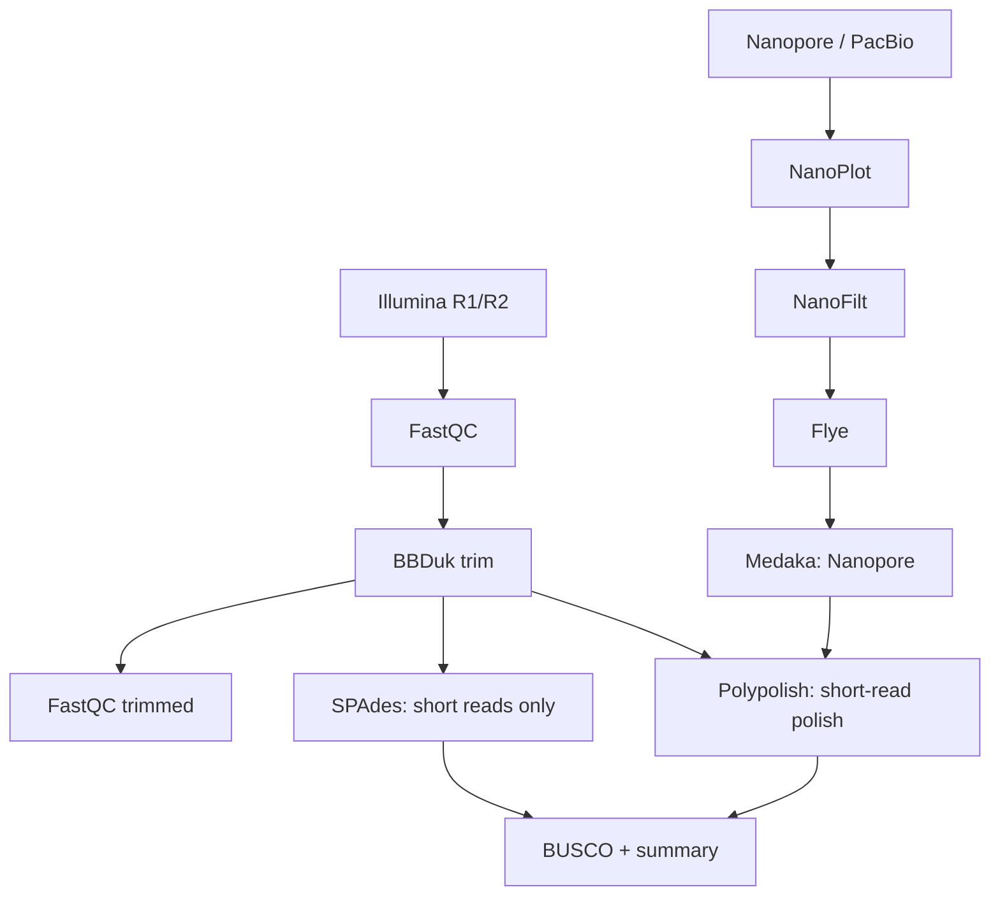

# Genome-Forge

[](https://github.com/Soumocore/Genome-Forge/actions/workflows/shellcheck.yml)
[](LICENSE)


**One command to go from raw reads to a polished, validated genome assembly, whatever reads you have.**
Illumina (paired or single-end), Nanopore, PacBio, or an existing assembly: Genome-Forge looks at your inputs and picks the right route.

```bash
./run_pipeline.sh --r1 S1_R1.fastq.gz --long S1_ont.fastq.gz
```

> **Status:** v1.0. Command-line handling, input checks and the multi-sample logic are tested; validation on more real datasets is ongoing. Found a problem or have a dataset that breaks it? Please [open an issue](https://github.com/Soumocore/Genome-Forge/issues).

## Why Genome-Forge?

- **Works with what you have.** No separate scripts per data type.
- **Beginner-safe.** Clear errors for missing, empty or corrupt files; auto-detects R2 from R1; sensible defaults.
- **Restartable.** Finished steps are skipped, so a crashed run picks up where it stopped.
- **Many samples at once.** Give it a table and it processes every sample, reporting any that fail.
- **Reproducible.** One conda environment file per tool group, and a log for every tool.

## Workflow



| You provide | What runs |
|---|---|
| Illumina paired-end **+** Nanopore | QC, trim/filter, **Flye**, **Medaka**, **Polypolish**, BUSCO |
| Illumina paired-end **+** PacBio | the same, minus Medaka (Nanopore-only) |
| Nanopore or PacBio only | QC, filter, **Flye** (+ **Medaka** for ONT), BUSCO |
| Illumina only (paired or single-end) | QC, trim, **SPAdes**, BUSCO |
| An existing assembly (+ optional reads) | polish and/or BUSCO only |
| A table of many samples | all of the above, one row per sample |

Input files can be `.fastq` or `.fq`, with or without `.gz`, with any file names.

## Install

```bash
git clone https://github.com/Soumocore/Genome-Forge.git
cd Genome-Forge
# Install Miniforge first if you have no conda: https://github.com/conda-forge/miniforge
bash scripts/setup_envs.sh        # creates: bioinfo, bioinfo-medaka, bioinfo-busco
conda activate bioinfo
```

Windows users: run it inside [WSL](https://learn.microsoft.com/windows/wsl/install) (Ubuntu).

Optionally put the script on your PATH so you can run it from any folder:

```bash
sudo ln -s "$PWD/run_pipeline.sh" /usr/local/bin/run_pipeline.sh
```

## Run it

Run the command from the folder where your data is; relative paths are resolved from there.

```bash
# Illumina + Nanopore (R2 is found automatically from R1's name)
./run_pipeline.sh --r1 reads/S1_R1.fastq.gz --long reads/S1_ont.fastq.gz --genome-size 5m

# Illumina only, paired or single-end
./run_pipeline.sh --r1 S1_R1.fq.gz --r2 S1_R2.fq.gz
./run_pipeline.sh --r1 single.fq.gz --r2 none

# Nanopore only (older/noisier data: --long-type ont-raw)
./run_pipeline.sh --long ont.fastq.gz --long-type ont-raw

# PacBio HiFi (skips the long-read filter)
./run_pipeline.sh --long hifi.fastq.gz --long-type pacbio-hifi --no-filter

# I already have an assembly: polish with short reads and check completeness
./run_pipeline.sh --assembly draft.fasta --r1 S1_R1.fq.gz

# Many samples
./run_pipeline.sh --samplesheet examples/samplesheet.tsv

# A different organism? choose the right BUSCO lineage, or let BUSCO pick
./run_pipeline.sh --r1 ... --lineage fungi_odb10
./run_pipeline.sh --r1 ... --lineage auto
```

Try it without any long reads using the small public test set:

```bash
bash scripts/download_test_data.sh                       # Illumina E. coli, ~100 MB
./run_pipeline.sh --r1 data/raw/sample_R1.fq.gz --skip busco
```

## Options

Run `./run_pipeline.sh -h` for the full list. The main ones:

| Option | Meaning |
|---|---|
| `--r1`, `--r2` | Illumina reads (`--r2` auto-detected; `--r2 none` = single-end) |
| `--long`, `--long-type` | long reads and their type: `ont-hq` (default), `ont-raw`, `pacbio-hifi`, `pacbio-clr` |
| `--assembly` | existing assembly to polish/validate |
| `--samplesheet` | tab-separated table for many samples (`-` = empty cell) |
| `--sample`, `-o`, `-t` | sample name (default: from the file name), output folder (default `results`), threads (default: all cores) |
| `--lineage` | BUSCO lineage (default `bacteria_odb10`; `auto`, `auto-prok`, `auto-euk` also work) |
| `--genome-size`, `--medaka-model` | optional hints for Flye / Medaka |
| `--no-filter` | skip long-read filtering |
| `-s LIST`, `--skip LIST` | run only / skip steps |
| `-f` | force re-run (otherwise finished steps are skipped, so a crashed run resumes) |
| `-c FILE` | file of defaults; see `config/config.sh` (command-line wins) |

Steps: `check, qc_raw, trim, qc_trim, long_qc, long_filter, assemble, medaka, polish, busco, summary`

Sample sheet format (`examples/samplesheet.tsv`, columns separated by **tabs**): `sample  short_r1  short_r2  long  assembly`. A failed sample is reported at the end and does not stop the others.

## Output (`<out>/<sample>/`)

```
qc_raw/ trimmed/ qc_trim/        short-read QC and cleaned reads
long_qc/{raw,filtered}/          NanoPlot reports
long_filtered/                   filtered long reads
assembly/{flye|spades,medaka,polish}/
busco/                           completeness report
final/final_assembly.fasta       best available assembly
summary.txt                      contigs / length / N50 / flagstat / BUSCO
logs/                            one log per tool
```

`summary.txt` has this layout (values depend on your data):

```
Sample: <name>
flye/assembly.fasta:  contigs=<n> total_bp=<n> longest_bp=<n> N50=<n>
medaka/consensus.fasta: contigs=<n> total_bp=<n> longest_bp=<n> N50=<n>
polish/final_polished.fasta: contigs=<n> total_bp=<n> longest_bp=<n> N50=<n>
--- flagstat ---  (mapping statistics of short reads against the polished assembly)
--- BUSCO ---     (Complete / Fragmented / Missing)
```

## Reading the results

- **FastQC**: a WARN is not a failure; compare adapter content and per-base quality before and after trimming.
- **N50**: higher usually means a more contiguous assembly; a complete bacterial genome is often one chromosome plus plasmids.
- **flagstat**: above 95% mapped is healthy; very low mapping suggests contamination, mismatched samples, or a poor assembly.
- **BUSCO**: mid-90s % complete or higher is strong. Use a lineage that matches your organism.

## Important notes

- Short and long reads must come from the **same organism/strain**.
- Defaults are tuned for small bacterial genomes; for large genomes raise `--threads`, supply `--genome-size`, and expect long runtimes.
- Medaka works best with a model matching your basecaller and flowcell (`--medaka-model`).
- BUSCO downloads its lineage dataset on first use, so it needs internet.
- More help: [`docs/TROUBLESHOOTING.md`](docs/TROUBLESHOOTING.md), [`docs/CONCEPTS.md`](docs/CONCEPTS.md).

## Tools

FastQC · BBDuk (BBMap) · NanoPlot · NanoFilt · Flye · SPAdes · Medaka · BWA · SAMtools · Polypolish · BUSCO.
Please also cite these tools when you publish results; Genome-Forge only wires them together.

## Citing

If Genome-Forge helped your work, use the **Cite this repository** button in the sidebar (from `CITATION.cff`).

## Contributing

Bug reports, test datasets and pull requests are welcome. See [CONTRIBUTING.md](CONTRIBUTING.md).

## License

MIT, see [LICENSE](LICENSE).
